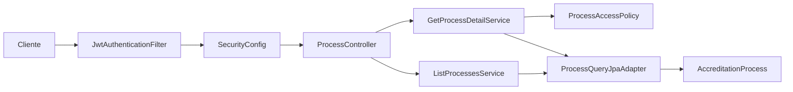
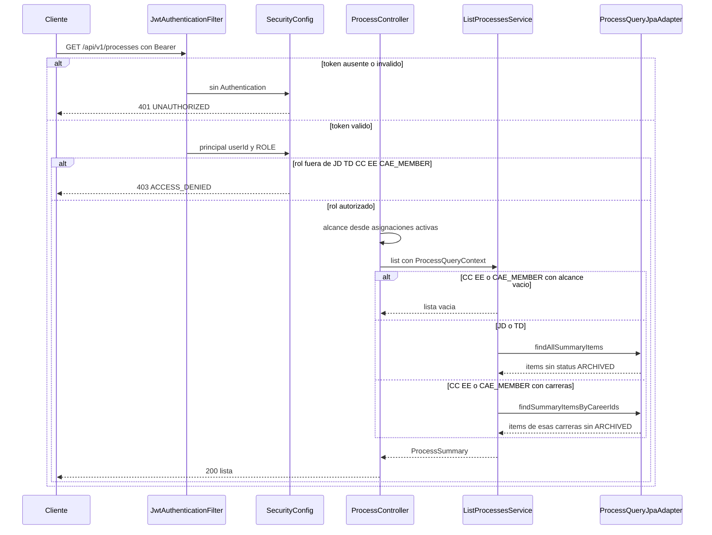

# Architecture Analysis

## Architecture Analysis

### System Overview

Monolito modular. El backend Java expone `/api/v1` y persiste en PostgreSQL en los perfiles `dev` y `prod`. El perfil por defecto usa H2 en memoria. El frontend React es un cliente aparte; esta pasada solo lo ojeó. El intent de estadísticas no toca la UI.

### Architectural Style

Hexágono en un solo despliegue. Evidencia: `domain.model` no importa Spring ni JPA; los casos de uso son interfaces en `application.port.in` e implementaciones Java puras cableadas en `ProcessModuleConfig`; JPA vive en `adapter.out.persistance`; HTTP y seguridad viven en `adapter.in`. Los controladores devuelven DTO, no entidades.

Hay un atajo: `ProcessController` inyecta el puerto de salida `UserProgramAssignmentRepositoryPort` para armar el alcance.

### Component Relationships

Texto: el cliente pasa por el filtro JWT y la cadena de seguridad. `ProcessController` llama al listado o al detalle. Solo el detalle consulta `ProcessAccessPolicy`. Ambos casos leen por `ProcessQueryJpaAdapter`, que traduce la entidad JPA al modelo `AccreditationProcess` o a un ítem de lista.

### Data Flow

El JWT (subject = userId, claims `role` y `programScope`) se valida en `JwtAuthenticationFilter`. Si es válido, el principal es el UUID y la autoridad es `ROLE_<rol>`. El claim de carreras queda en `Authentication.details`.

Para listar, `ProcessController.buildQueryContext` ignora ese claim y vuelve a leer asignaciones activas en base de datos. `ListProcessesService` parte el universo: `JD`/`TD` llaman `findAllSummaryItems`; `CC`/`EE`/`CAE_MEMBER` llaman `findSummaryItemsByCareerIds`; alcance nulo o vacío devuelve lista vacía sin consultar. El adaptador descarta `status = ARCHIVED` en memoria. El ítem resultante no incluye `operationalMode`.

La columna `accreditation_processes.operational_mode` (`VARCHAR(32)`, default `ACTIVE`) admite `ACTIVE`, `AUDIT_READONLY` e `IMPROVEMENT_MONITORING` (`V17__methodological_workflow_stages.sql`). El dominio refleja eso en `OperationalMode`. `ProcessPersistenceMapper.toDomain` sí mapea el modo; `toJpaEntity` no lo copia. El estado de negocio es el enum `ProcessStatus`: `ACTIVE`, `CLOSED`, `ARCHIVED`.

Perfiles de esquema: por defecto H2, `ddl-auto: create-drop`, Flyway apagado; `dev` PostgreSQL, `ddl-auto: update`, Flyway apagado; `prod` PostgreSQL, `ddl-auto: validate`, Flyway encendido con `baseline-on-migrate`. Entre V1 y V25 no hay `CREATE TABLE accreditation_processes`; V7 ya la referencia.

`ProcessFreezeController` es otro camino: el rol `TD` congela en `AUDIT_READONLY` y el alcance lo toma del claim JWT, no de las asignaciones.

### Key Design Decisions

- Sesión stateless. Todo `/api/v1/**` exige Bearer, salvo `POST /api/v1/auth/login`, CORS `OPTIONS` y Swagger.
- Sin token válido el filtro no autentica y `RestAuthenticationEntryPoint` responde 401 `{ error: UNAUTHORIZED }`. Rol insuficiente: 403 `{ error: ACCESS_DENIED }`.
- Fuera de alcance en el detalle se disfraza de proceso inexistente (404). El listado, en cambio, filtra y puede devolver vacío.
- Los servicios de proceso no son `@Service`; `ProcessModuleConfig` publica los beans. Así el paquete de aplicación no depende del estereotipo de Spring en cada clase, aunque el config sí es Spring.

### Improvement Opportunities

- Incluir `operationalMode` en el contrato de consulta de listado, o agregar una consulta de agregados, antes de armar `byStatus`, `byOperationalMode` y `frozenCount`.
- Unificar la fuente del alcance (asignaciones vigentes o claim JWT) entre listado y freeze.
- Filtrar `ARCHIVED` en la consulta, no después de materializar todas las filas.
- Declarar `GET /stats` como patrón literal en `ProcessController` antes de `/{processId}`.

## Interaction Diagrams

Transacción actual más cercana al resumen futuro: listar los procesos visibles.

Texto: el cliente pide `GET /api/v1/processes` con Bearer. Token ausente o inválido: el filtro no deja autenticación y la cadena responde 401. Token válido: se fija el usuario y un solo rol. Si el rol no es `JD`, `TD`, `CC`, `EE` ni `CAE_MEMBER`, la respuesta es 403. Si el rol está autorizado, el controlador arma el contexto con las asignaciones activas del usuario. Carrera vacía para `CC`, `EE` o `CAE_MEMBER`: lista vacía. `JD` o `TD`: todos los ítems no archivados. Esos tres roles con carreras: solo esas carreras, también sin archivados. El controlador responde 200 con los resúmenes. Ese cuerpo no trae `operationalMode`.
