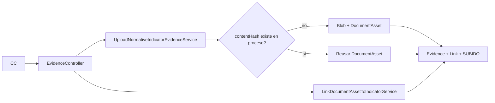

# Design Doc `DD-UC-004-M7` — DocumentAsset M:N

## 1. Objetivo y contexto

Un PDF institucional no debe duplicarse en disco/MinIO cuando alimenta **varios indicadores** del mismo proceso. M7 introduce `DocumentAsset` (blob + folio) e `IndicatorEvidenceLink` (M:N) **sin** romper el contrato vigente `POST /indicators/{id}/evidences` ni la cabecera `Evidence` 1:1 por indicador.

**FSD:** [FSD-UC-004](../product/uc/FSD-UC-004.md), [FSD-UC-005](../product/uc/FSD-UC-005.md)  
**ADR:** [ADR-0005](../adr/ADR-0005-workflow-metodologico-evaluacion-transversal.md) (no se crea ADR nuevo).

### Alcance

**Dentro:** persistencia V19, deduplicación por SHA-256, API link + GET asset, UI modal (vincular existente), backfill, tests.

**Fuera:** FODA (M8), congelamiento (M10), foliado institucional DUEA oficial, N documentos por el mismo indicador, UC-015 SMTP real.

### Object storage y lock (FEAT-02 / `PR-IMPL-041`, 2026-10-17)

- `DocumentAsset.storageKey` es una **clave opaca** (`evidences/{id}/v{n}/{file}`), nunca `file.getAbsolutePath()`.
- Runtime Docker: `sigesa.evidence.storage=s3` → Silo (`pgsty/silo:RELEASE.2026-10-15T00-00-00Z`, API S3/MinIO, `SIGESA_S3_ENDPOINT=http://minio:9000`). H2/tests: `local`. Imágenes oficiales MinIO (Hub/Quay) no se usan: pull anónimo 401/denied.
- Cambio a S3 remoto: mismas variables, otro endpoint. Un solo `EvidenceBlobStoragePort`.
- Upload concurrente: `evidence_upload_lock` (PK `indicator_id`, `INSERT` atómico; TTL 5 min). No `ConcurrentHashMap`. Flyway **V23**.

## 2. Diseño

### Enfoque

1. `DocumentAsset` = identidad física (`contentHash` único si hay archivo; URL externa hasheada con prefijo actual `external-url:`).
2. `Evidence` permanece **una cabecera por indicador** (`uk_evidence_normative_indicator`).
3. `IndicatorEvidenceLink` (`indicatorId`, `documentAssetId`, `evidenceId`, `isPrimaryReference`) habilita M:N.
4. Upload existente: si el hash ya existe **en el mismo proceso**, reutilizar asset (`reusedAsset: true`); si no, crear asset + almacenar blob.
5. Link explícito: `POST .../evidences/link` sin multipart.

### Modelo (Flyway **V19**)

V18 ya existe (`normative_evidence_legacy_nullable`). M7 **no** reutiliza V18.

| Tabla | Campos | Notas |
|-------|--------|-------|
| `document_assets` | `id`, `process_id`, `folio_code` UNIQUE, `title`, `storage_key`, `content_hash`, `is_institutional`, `uploaded_by`, `created_at` | UNIQUE `(process_id, content_hash)` |
| `indicator_evidence_links` | `id`, `indicator_id`, `document_asset_id`, `evidence_id`, `is_primary_reference`, `created_at` | UNIQUE `(indicator_id, document_asset_id)` |

**Backfill:** por cada `evidence` con `normative_indicator_id` + latest `evidence_version`, insertar `document_assets` (agrupar por `content_hash` + proceso del indicador) y un link primario.

`folio_code`: `SIGESA-{yyyyMMdd}-{8 hex del hash}`.

### API

| Método | Ruta | Rol | Notas |
|--------|------|-----|-------|
| POST | `/api/v1/indicators/{indicatorId}/evidences` | CC | Multipart vigente; 201 + `documentAssetId`, `folioCode`, `reusedAsset` |
| POST | `/api/v1/indicators/{indicatorId}/evidences/link` | CC | JSON `{ "documentAssetId": uuid }` |
| GET | `/api/v1/document-assets/{documentAssetId}` | CC, TD, JD | Metadatos + `linkedIndicatorIds[]` |
| GET | `/api/v1/indicators/{indicatorId}/evidences` | CC, TD, JD | Incluir folio/asset en cada ítem |

Errores nuevos: `409 INDICATOR_ALREADY_HAS_EVIDENCE`, `404 DOCUMENT_ASSET_NOT_FOUND`. Scope: asset de otro proceso → `403 PROGRAM_SCOPE_DENIED`.

### Capas hexagonales

| Capa | Artefacto |
|------|-----------|
| Domain | `DocumentAsset`, `IndicatorEvidenceLink`; excepciones `IndicatorAlreadyHasEvidenceException`, `DocumentAssetNotFoundException` |
| Port in | `UploadNormativeIndicatorEvidenceUseCase` (extender resultado), `LinkDocumentAssetToIndicatorUseCase`, `GetDocumentAssetUseCase` |
| Port out | `DocumentAssetPort` (findByHashInProcess, save, findById) |
| Service | extender upload; `LinkDocumentAssetToIndicatorService`; `GetDocumentAssetService` |
| Adapter in | `EvidenceController` o `NormativeIndicatorEvidenceController` + DTOs OpenAPI |
| Adapter out | JPA `DocumentAssetEntity`, `IndicatorEvidenceLinkEntity` |

### Frontend

- Modal de carga: checkbox/selector **«Usar documento ya cargado en este proceso»** (lista assets del proceso vía detalle de evidencias existentes o GET search).
- Mostrar `folioCode` en lista de evidencias del indicador.
- Solo hooks Orval; tokens de diseño SIGESA.

## 3. Alternativas

| Alternativa | ¿Elegida? |
|-------------|-----------|
| A. Asset + link M:N, Evidence 1:1 indicador (ADR-0005) | **sí** |
| B. N EvidenceVersion compartiendo storageKey sin entidad Asset | no — sin folio ni identidad |
| C. N evidencias por indicador desde M7 | no — rompe unique vigente; queda M7+ |

## 4. Impacto specs vivas

| Artefacto | Cambio | ¿Delta DTI? |
|-----------|--------|-------------|
| `docs/product/FSD.md` | UC-004/005 En Curso M7 | no (previsto ADR-0005) |
| `docs/product/uc/FSD-UC-004.md` / `005.md` | Flujos M:N | no |
| `docs/product/modelo_datos.md` | V19 | no |
| `docs/product/api_contracts.md` | API-EVD-01 ext + EVD-06/07 | sí menor → DTP changelog |
| `docs/product/DTP.md` | V19 + MOD-EVIDENCE | sí → sync post-código |

## 5. Prompts

| Prompt | Tarea |
|--------|-------|
| `PR-IMPL-M7-004` | Full-stack M7 |

## 6. Plan de pruebas

- **Unit:** reuso de hash; link a indicador vacío; 409 si ya tiene evidencia; 403 asset de otro proceso.
- **WebMvc:** POST upload 201 con `reusedAsset`; POST link; GET asset.
- **IT/Flyway:** V19 + backfill no duplica hash.
- **Frontend:** Vitest modal link; Playwright opcional si hay seed con 2 indicadores vacíos.

## 7. Criterios de hecho

- [ ] V19 aplicada; backfill idempotente.
- [ ] Upload no duplica blob a igual hash en el proceso.
- [ ] Link M:N deja N indicadores `SUBIDO` con el mismo `folioCode`.
- [ ] DELETE evidencia sigue `409 EVIDENCE_IMMUTABLE` (UC-005).
- [ ] Orval regenerado; UI muestra folio.
- [ ] `@save-prompt-mapping` + `@dtp-sync`.
