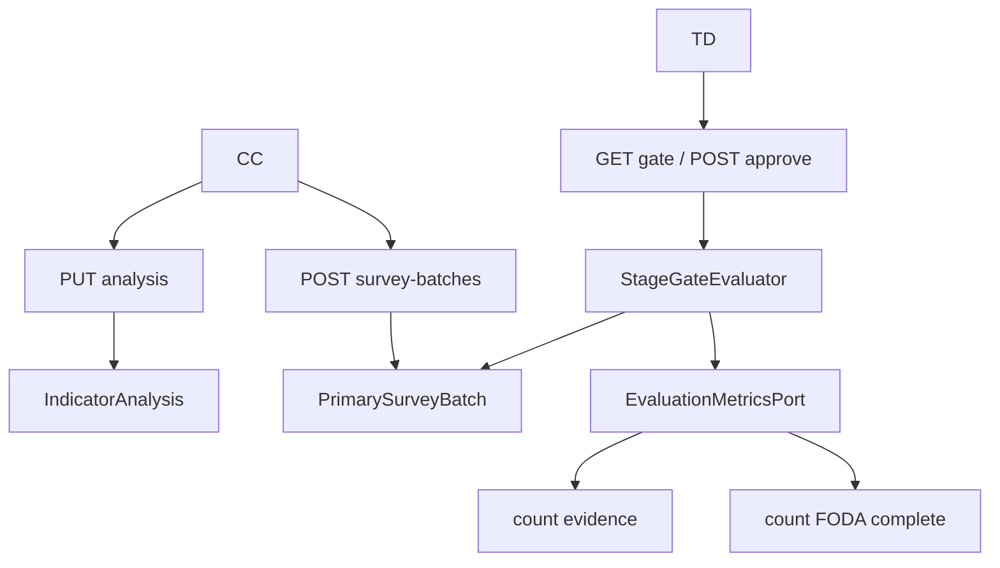

# Design Doc `DD-UC-029` — M8 FODA y compuertas E2/E3

## 1. Objetivo y contexto

Habilitar el análisis FODA por indicador, un tablero de completitud (UC-029) y hacer **operativa** la compuerta E2→E3 (hoy el evaluador ya exige evidencias + encuesta, pero no hay API de lotes). Extender `StageGateEvaluator` a **SYSTEMATIZATION** (cierre E3: FODA 100% + entregables E3).

**FSD:** [FSD-UC-029](../product/uc/FSD-UC-029.md), [FSD-UC-028](../product/uc/FSD-UC-028.md)  
**ADR:** [ADR-0005](../adr/ADR-0005-workflow-metodologico-evaluacion-transversal.md) (no se crea ADR nuevo).

### Alcance

**Dentro:** Flyway V20 `indicator_analysis`; upsert FODA; GET métricas; CRUD lotes encuesta (tabla M6); entregables E3 en catálogo + backfill; gate SYSTEMATIZATION; UI FODA en indicador + métricas + formulario lote E2.

**Fuera:** `CAE_MEMBER` / `IndicatorDelegation`; Plan de Mejoras (M9); freeze (M10); N documentos por el mismo indicador.

## 2. Diseño

### Enfoque

1. Un `IndicatorAnalysis` por indicador (`UNIQUE indicator_id`).
2. Completo ⇔ `fodaQuadrant` + `compliance` + `synthesis` (trim no vacío).
3. `EvaluationMetricsPort` añade conteo FODA y se expone por REST.
4. `PrimarySurveyBatch`: alta/listado REST (la tabla ya existe desde V17).
5. `StageDeliverableCode` E3: `FODA_FORMS_COMPLETE`, `SYNTHESIS_MATRIX`. Bootstrapper: si la etapa ya existe, **añadir** entregables faltantes (no retornar ciego).
6. `evaluateCollection` se mantiene (E2→E3). `evaluateSystematization` nuevo.



### Modelo (Flyway **V20**)

V19 es DocumentAsset. M8 **no** reutiliza V19.

| Tabla | Campos | Notas |
|-------|--------|-------|
| `indicator_analysis` | `id`, `indicator_id` UNIQUE FK, `process_id` FK, `foda_quadrant`, `compliance`, `synthesis`, `author_id`, `created_at`, `updated_at` | Completo = tres campos de negocio presentes |

**Enums**

- `fodaQuadrant`: `STRENGTH` \| `WEAKNESS` \| `OPPORTUNITY` \| `THREAT`
- `compliance`: `COMPLIES` \| `PARTIAL` \| `DOES_NOT_COMPLY`

**Backfill E3:** para cada `methodological_stages.code = SYSTEMATIZATION` insertar entregables E3 si no existen.

`primary_survey_batches` ya existe (V17): `process_id`, `audience` (max 32), `responses_count`, `document_asset_id` nullable, `registered_at`.

### API

| Código | Método | Ruta | Rol |
|--------|--------|------|-----|
| API-WF-09 | GET | `/api/v1/processes/{processId}/evaluation-metrics` | CC, TD, JD |
| API-WF-10 | GET/PUT | `/api/v1/indicators/{indicatorId}/analysis` | GET: CC,TD,JD · PUT: CC |
| API-WF-11 | POST | `/api/v1/processes/{processId}/survey-batches` | CC |
| API-WF-12 | GET | `/api/v1/processes/{processId}/survey-batches` | CC, TD, JD |
| API-WF-07 | GET | `…/stages/{stageId}/gate` | TD (sin cambio de ruta; reglas E2/E3) |

**GET metrics 200:**

```json
{
  "processId": "uuid",
  "totalIndicators": 10,
  "indicatorsWithEvidence": 10,
  "evidenceCompletenessRatio": 1.0,
  "fodaComplete": 4,
  "fodaCompletenessRatio": 0.4,
  "primarySurveyBatchCount": 1
}
```

**PUT analysis body:** `{ "fodaQuadrant": "WEAKNESS", "compliance": "PARTIAL", "synthesis": "…" }`  
**GET analysis 404** `ANALYSIS_NOT_FOUND` si nunca se guardó (no es error de indicador).  
**PUT 200** upsert.

**POST survey-batches:** `{ "audience": "ESTUDIANTES", "responsesCount": 120, "documentAssetId": null }` → **201**.

Errores: `404 PROCESS_NOT_FOUND` / `INDICATOR_NOT_FOUND`; `403 FORBIDDEN_ROLE` / `PROGRAM_SCOPE_DENIED`; `400 VALIDATION_ERROR`; approve etapa `409 STAGE_GATE_BLOCKED` + `failedRules[]`.

### Frontend

- Panel métricas en detalle de proceso (ratios evidencia/FODA + conteo encuestas).
- Formulario FODA en el collapsible del indicador (`canEditFoda` = rol CC).
- En timeline E2: alta de lote de encuesta (audience + n.º respuestas).
- Tokens institucionales; solo Orval.

### Tests

- `StageGateEvaluator`: E2 fail sin encuesta; E2 pass con evidencia+encuesta+entregables; E3 fail FODA incompleto; E3 pass FODA+entregables.
- Servicios upsert/métricas/survey ≥90 %.
- WebMvc: 201 lote, PUT FODA, GET metrics, 403 TD en PUT FODA.
- Vitest: panel métricas + formulario FODA.

## 3. No hacer

- No inventar UC-032+.
- No tocar `docs/baseline/`.
- No rol `CAE_MEMBER` ni tabla `indicator_delegations`.
- No `ImprovementPlanItem`.
- Flyway siguiente libre = **V20** (verificar listado `V*.sql` antes de escribir).
