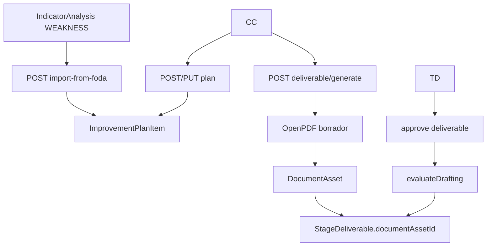

# Design Doc `DD-UC-031` — M9 Plan de Mejoras y E4

## 1. Objetivo y contexto

Instanciar `ImprovementPlanItem` (auto-import desde FODA `WEAKNESS`), generar **borradores PDF** de los cuatro entregables E4 como `DocumentAsset`, y evaluar la compuerta **DRAFTING** (E4→E5).

**FSD:** [FSD-UC-031](../product/uc/FSD-UC-031.md), [FSD-UC-028](../product/uc/FSD-UC-028.md)  
**ADR:** [ADR-0005](../adr/ADR-0005-workflow-metodologico-evaluacion-transversal.md). **No** hay plantillas oficiales CNACU: el PDF lleva leyenda de borrador SIGESA.

### Alcance

**Dentro:** V21 `improvement_plan_items`; CRUD + import FODA; códigos E4 + backfill; `documentAssetId` en dominio `StageDeliverable`; generate PDF; `evaluateDrafting`; UI plan + botón generar en timeline DRAFTING.

**Fuera:** M11 ciclo E7; freeze M10; CAE; plantillas CNACU reales; E5 deliverables.

## 2. Diseño

### Modelo (Flyway **V21**)

V20 es `indicator_analysis`. M9 **no** reutiliza V20.

| Tabla | Campos | Notas |
|-------|--------|-------|
| `improvement_plan_items` | `id`, `process_id` FK, `source_indicator_id` FK nullable, `objective` TEXT NOT NULL, `activity` TEXT, `responsible_id` FK nullable, `deadline` DATE nullable, `progress` INT NOT NULL DEFAULT 0, `created_at`, `updated_at` | UNIQUE `(process_id, source_indicator_id)` **WHERE source_indicator_id IS NOT NULL**; CHECK progress 0–100 |

Backfill E4: para cada etapa `DRAFTING` insertar los 4 códigos si faltan. El bootstrapper `ensureMissingDeliverables` ya cubre procesos vivos si se actualiza `StageDeliverableCode.forStage(DRAFTING)`.

Extender dominio `StageDeliverable` con `documentAssetId` (la columna JPA ya existe desde V17). Mapper + DTO de timeline.

### Enums E4

`SELF_ASSESSMENT_REPORT` · `OFFICIAL_DATA_FORM` · `IMPROVEMENT_PLAN` · `ACADEMIC_DEV_PLAN`

### Generación PDF

Puerto nuevo `DraftingDocumentRendererPort.render(title, paragraphs) → byte[]` (OpenPDF, no acoplar `PdfRendererPort` del reporte ejecutivo).

Contenido mínimo:

| Código | Fuente |
|--------|--------|
| SELF_ASSESSMENT_REPORT | métricas + síntesis FODA por indicador |
| OFFICIAL_DATA_FORM | metadatos de proceso + leyenda “no es formulario CNACU oficial” |
| IMPROVEMENT_PLAN | filas del plan |
| ACADEMIC_DEV_PLAN | análisis STRENGTH/OPPORTUNITY |

SHA-256 → `DocumentAsset` + `EvidenceBlobStoragePort`. Regenerar solo si entregable no `APPROVED`.

### Compuerta DRAFTING

Para cada código E4: existe entregable, `documentAssetId != null`, `approvalStatus == APPROVED`. Si falta alguno → BLOCK.

Aprobar entregable E4 sin asset → `409 DELIVERABLE_WITHOUT_DOCUMENT`.

### API

| Código | Método | Ruta | Rol |
|--------|--------|------|-----|
| API-WF-13 | GET | `/processes/{id}/improvement-plan` | CC, TD, JD |
| API-WF-14 | POST | `/processes/{id}/improvement-plan` | CC |
| API-WF-15 | POST | `/processes/{id}/improvement-plan/import-from-foda` | CC |
| API-WF-16 | PUT | `/processes/{id}/improvement-plan/{itemId}` | CC |
| API-WF-17 | POST | `/processes/{id}/stages/{stageId}/deliverables/{deliverableId}/generate` | CC |

**Item DTO:** `{ id, processId, sourceIndicatorId, objective, activity, responsibleId, deadline, progress, createdAt, updatedAt }`

**POST create:** `{ objective, activity?, responsibleId?, deadline?, progress? }` progress default 0.

**PUT:** mismos campos editables (no cambia `sourceIndicatorId`).

**Import 200:** `{ importedCount, skippedCount, items[] }` — skip si ya hay fila para ese indicador.

**Generate 201:** `{ deliverableId, documentAssetId, folioCode, title }` — DTO de etapa actualizado en GET stages.

### Frontend

- Sección **Plan de Mejoras** en detalle de proceso: tabla, alta, import, edición (CC).
- Timeline: botón **Generar borrador** en entregables E4 de etapa DRAFTING (`canSubmit` CC); mostrar folio si hay asset.
- Tokens institucionales; solo Orval.

### Tests

- Import idempotente; UNIQUE source.
- Gate DRAFTING fail sin PDF / sin approve; pass con 4 APPROVED+asset.
- Generate 409 si APPROVED o etapa ≠ DRAFTING.
- WebMvc 201/200/403; Vitest tabla plan + botón generar.

## 3. No hacer

- No `docs/baseline/`.
- No inventar UC-032.
- No modo `IMPROVEMENT_MONITORING` ni evidencia de avance periódica (M11).
- Flyway siguiente libre = **V21**.
