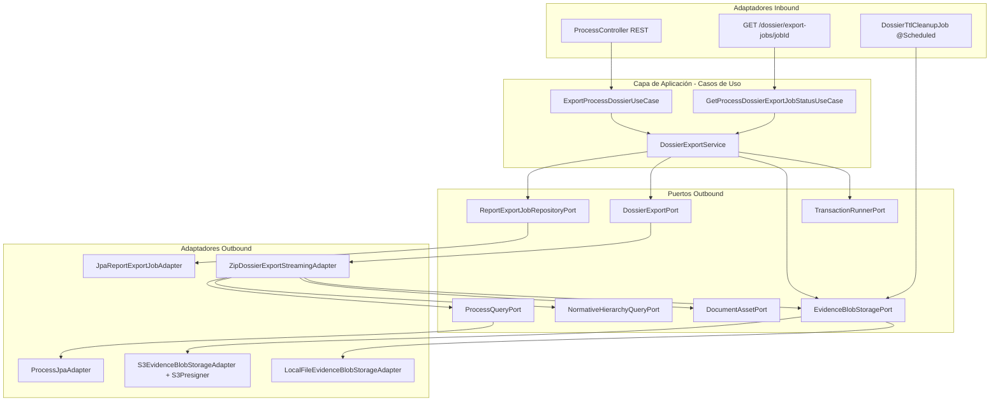
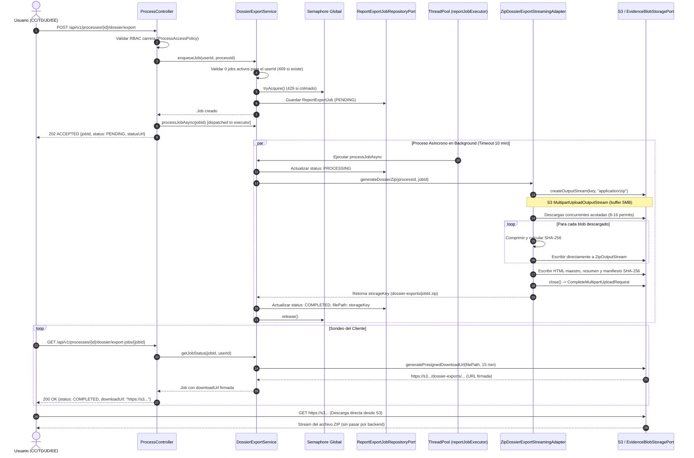

# Design Doc `DD-UC-032` — Exportación Asíncrona del Dossier Digital

## 1. Objetivo y Contexto

Implementar y optimizar el caso de uso de exportación del **Dossier Digital de Acreditación** en formato ZIP foliado y jerárquico bajo arquitectura hexagonal estricta, resolviendo cuellos de botella de memoria y disco:

1. **Zero Disco Efímero:** Supresión total de `Files.createTempFile` y archivos intermedios en `/tmp` o `./data`.
2. **Zero OutOfMemoryError en Heap:** Eliminación de `Files.readAllBytes`. El flujo de compresión escribe directamente desde `ZipOutputStream` sobre el `OutputStream` de subida en fragmentos acotados (Multipart Upload en S3 / stream directo en storage local).
3. **Descarga Paralela Acotada desde S3:** Descarga de blobs de evidencia con pool concurrente regulado por un semáforo (8–16 hilos) y pipeline productor-consumidor acotado.
4. **Protección de Hilos y Backpressure:** Semáforo global de jobs concurrentes (devuelve HTTP `429 Too Many Requests` si está saturado), límite de 1 exportación activa por usuario y timeout estricto de 10 minutos por job.
5. **Ciclo de Vida y TTL:** Almacenamiento temporal en `dossier-exports/` con purga automática programada y al arranque tras 24–48 horas de vida.
6. **Descarga por URL Firmada (Presigned URL):** Generación de URLs prefirmadas de S3 (15 min) para descarga directa cliente-S3 sin intermediación de sockets en el backend.
7. **Control RBAC por Carrera:** Restricción estricta para `ROLE_CC` mediante validación contra sus asignaciones de carrera.

---

## 2. Arquitectura Hexagonal y Puertos

---

## 3. Diagrama de Secuencia del Flujo Asíncrono

---

## 4. Estrategia de Concurrencia y Control de Memoria

### 4.1 Bounded Parallel Evidence Fetching (Semáforo de 8–16 hilos)
Para optimizar el I/O sin saturar los descriptores de red del SDK S3 ni la memoria:
1. Se recopila la lista completa de descriptores de documentos (`DocumentAsset`) del árbol normativo.
2. Un pool de descargas acotado por un `Semaphore(8)` dispara peticiones a `EvidenceBlobStoragePort.retrieve()`.
3. Una cola bloqueante acotada (`BlockingQueue` capacidad 16) amortigua las descargas hacia el hilo de compresión.
4. El hilo compresor toma de la cola y escribe consecutivamente en `ZipOutputStream`. Inmediatamente después de la escritura en el stream, el buffer de bytes queda elegible para recolección de basura (GC).
5. Memoria máxima de evidencias en heap: $\approx 16 \times \text{tamaño promedio de evidencia} \le 80\text{ MB}$.

### 4.2 S3 Multipart Streaming OutputStream
- S3 no admite streams de longitud desconocida en un `PutObject` simple.
- Se implementa un `S3MultipartOutputStream` interno que acumula bloques de 5 MB (tamaño mínimo de parte S3).
- Al alcanzar los 5 MB, se realiza `UploadPartRequest`.
- Al invocar `close()`, se sube el último fragmento ($< 5\text{ MB}$) y se ejecuta `CompleteMultipartUploadRequest`.
- Si ocurre un error, se ejecuta `AbortMultipartUploadRequest`, garantizando cero almacenamiento huérfano.
- Para almacenamiento local de desarrollo/test (`LocalFileEvidenceBlobStorageAdapter`), `createOutputStream` abre directamente un `FileOutputStream` sobre la ruta destino en `./data/dossier-exports/`, eliminando cualquier archivo temporal intermedio.

### 4.3 Límites Globales y Backpressure
- **Semáforo Global:** Máximo 4 exportaciones simultáneas (propiedad `sigesa.dossier.max-concurrent-jobs`).
- **Respuesta 429:** Si el semáforo no dispone de permisos al encolar, se lanza `TooManyConcurrentExportsException`, mapeada a `HTTP 429 Too Many Requests` con cabecera `Retry-After: 60`.
- **Límite por Usuario:** Verificación de `countActiveJobsByUserId > 0`. Si existe un job `PENDING` o `PROCESSING`, se rechaza con `409 Conflict`.
- **Timeout 10 Minutos:** La tarea asíncrona se ejecuta con límite de 10 minutos (`Future.get(10, TimeUnit.MINUTES)`). Al expirar, se interrumpe la tarea, se marca el job como `FAILED` con mensaje explicativo y se libera el semáforo en `finally`.

---

## 5. Limpieza y TTL de Objetos Temporales

1. Los archivos se identifican bajo el prefijo `dossier-exports/{jobId}/Dossier_...zip`.
2. Método `purgeExpiredDossierExports(Duration maxAge)` en `EvidenceBlobStoragePort`:
   - **En S3:** `listObjectsV2` con prefijo `dossier-exports/`. Compara `lastModified()` con el TTL configurado (por defecto 24 horas) y emite `deleteObjects`.
   - **En Local:** Recorre `./data/dossier-exports/` eliminando archivos cuya fecha de modificación supere el TTL.
3. Tarea programada `@Scheduled(cron = "${sigesa.dossier.cleanup-cron:0 0 * * * *}")` y ejecución en startup (`ApplicationRunner`).

---

## 6. Seguridad y RBAC

- Roles autorizados en endpoint: `hasAnyRole('JD', 'TD', 'CC', 'EE')`.
- Validación de carrera para `ROLE_CC`:
  - `ProcessAccessPolicy.assertCanAccess(role, process.getCareerId(), programScope, processId)`.
  - Si un usuario con rol `CC` intenta exportar un proceso ajeno a sus carreras asignadas, recibe `404 PROCESS_NOT_FOUND` para evitar divulgación de existencia de procesos ajenos.
- Descarga segura:
  - URLs firmadas con expiración de 15 minutos (`S3Presigner`).
  - Las credenciales o firmas no se comparten ni persisten.
