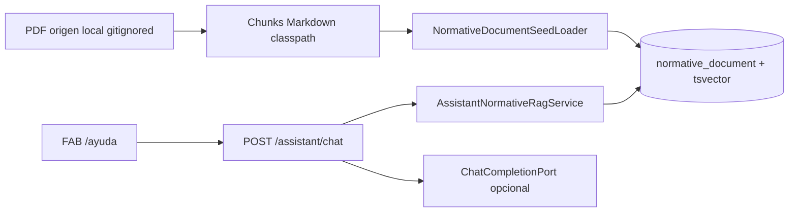

# Design Doc `DD-UC-033` — Corpus RAG ARCU-SUR 2023

## 1. Objetivo y contexto

Indexar el *Manual de procedimientos del Sistema ARCU-SUR 2023* para que el asistente existente responda con FTS, **sin un quinto agente** y **sin enviar el PDF al LLM**.

**FSD:** [`FSD-UC-033`](../product/uc/FSD-UC-033.md). **Motor:** [`PR-IMPL-032`](../prompts/impl/PR-IMPL-032.md) / [`DD-SYS-002`](DD-SYS-002.md).

**Dentro:** conversión PDF→Markdown por sección, classpath, upsert al boot, retiro de placeholders ARCU-SUR de demo, ampliación del detector de queries.

**Fuera:** PDFBox en caliente, pgvector, UI de citas, nuevo `agent=`, `docs/baseline/`.

## 2. Diseño

| Capa | Pieza |
|------|--------|
| Recursos | `backend/src/main/resources/normative-corpus/arcu-sur-2023/*.md` |
| Aplicación | `NormativeMarkdownDocumentParser` (front matter YAML) |
| Infra | `NormativeDocumentSeedLoader` upsert por `source_url` `https://arcusur.org/manual-procedimientos-2023#{slug}` |
| Persistencia | Tabla existente `normative_document` (V8); sin migración nueva |
| Entrada web | Sin DTO nuevo; mismo `POST /api/v1/assistant/chat` |

Otra máquina: funciona si trae el JAR/imagen **reconstruida** (los `.md` van en el classpath) + Postgres. El PDF en `tmp/rag-inbox/` no se despliega.

## 3. Alternativas consideradas

| Alternativa | ¿Elegida? |
|-------------|-----------|
| Nuevo `agent=docs` | No — misma tool en los 4 perfiles |
| Pegar el PDF entero al system prompt | No — ruido, tokens, no escala |
| Solo PDF en disco en runtime | No — no portable entre máquinas |
| Markdown por sección + FTS | Sí |
| pgvector | Fase 2 |

## 4. Impacto en specs vivas

- `docs/product/FSD.md` índice UC-033
- `docs/product/DTP.md` changelog RAG corpus
- `docs/design/assistant/TOOL-CATALOG.md` §2.0.1
- Sprint 03 `PM-037`

## 5. Validación

- Parser + recursos classpath: tests Maven.
- Log de boot: `RAG corpus ARCU-SUR 2023: 33 chunks upserted`.
- Smoke: pregunta de pares/cronograma → fragmento del manual, no demo DUEA placeholder.
