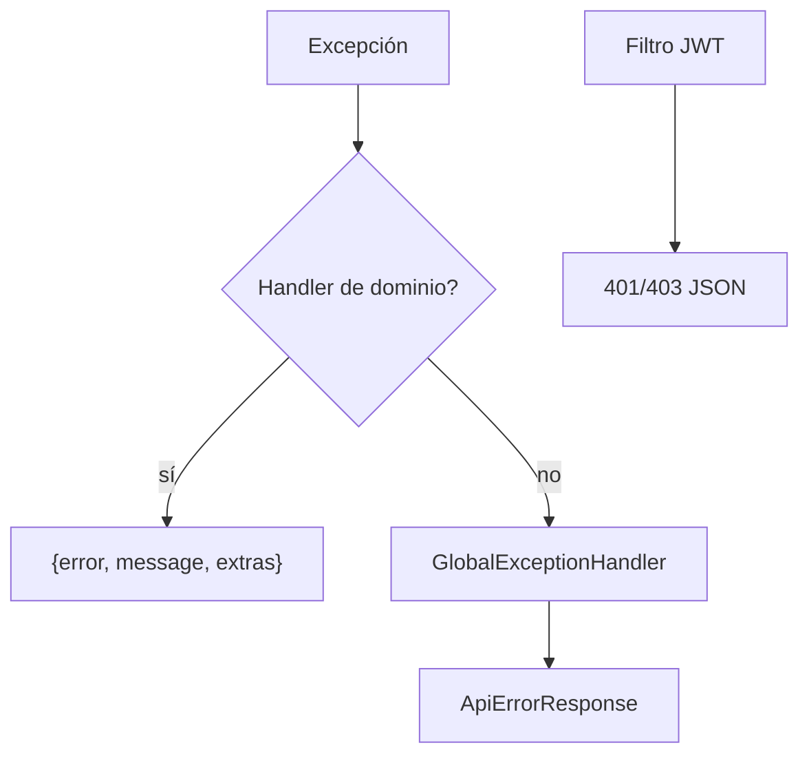

# Design Doc `DD-UC-034` — Envelope uniforme de errores REST

## 1. Objetivo

Cumplir [#67](https://github.com/AcredIA-UMSS/sigesa-acreditacion-umss/issues/67): respuestas de error consistentes, HTTP correcto, sin filtrar información sensible, con log interno.

## 2. Diseño

No se reescriben los `@RestControllerAdvice` de dominio (siguen `{error,message}` más campos extra de negocio como `pendingIndicators`). Se añade una **red de seguridad**:

| Pieza | Rol |
|-------|-----|
| `ApiErrorResponse` | DTO `{error, message, details?}` `@JsonInclude(NON_EMPTY)` |
| `GlobalExceptionHandler` | 400 validación/JSON, 404 ruta, 405/415, 500 genérico + log |
| `RestAuthenticationEntryPoint` / `RestAccessDeniedHandler` | 401/403 mismo envelope |
| `server.error.include-*=never` | Spring no serializa stack en el body |

500 nunca reenvía `ex.getMessage()`. El log sí lleva stack, URI y método; **no** Authorization ni body.

## 3. Alternativas

| Opción | Elegida |
|--------|---------|
| RFC 7807 `application/problem+json` | No — rompe Orval/`customFetch` (`error`+`message`) |
| Reescribir 80 handlers | No — mismo JSON de facto |
| Envelope + global fallback | Sí |

## 4. Validación

`GlobalExceptionHandlerWebMvcTest`: 400+details, JSON malformado, 500 sin SQL, 200 intacto.
