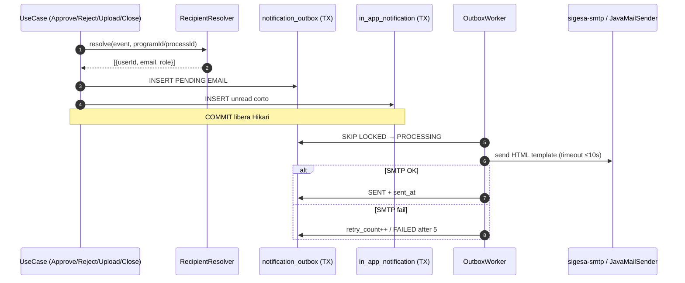

# Design Doc `DD-UC-038` — Notificaciones dual-canal (correo + in-app)

> **Qué es:** diseño de implementación de **FSD-UC-015** alineado a **BR-NOTIFY-001**.  
> **Qué no es:** ADR. La decisión de *mantener MOD-NOTIFY en el monolito* ya está en [`ADR-001`](../adr/ADR-001-extraer-modulo.md). Este DD describe el *cómo* del canal dual, resolución de destinatarios reales, SMTP interno, popover in-app y plantilla HTML de correo.  
> **Regla de oro:** no tocar `docs/baseline/`. Specs viven en `docs/product/`.

---

## 1. Objetivo y contexto

### 1.1 Qué resuelve

Hoy el outbox (`notification_outbox` + `NotificationOutboxWorker`) **encola** eventos de aprobación/rechazo/carga, pero:

1. El destinatario **no es un usuario real** (`recipientId` = `careerId`; email sintético `notificaciones-{uuid}@umss.edu.bo` / `coordinacion-{programId}@umss.edu.bo`).
2. `DefaultNotificationSenderAdapter` **solo loguea** — no hay `JavaMailSender` ni dependencia `spring-boot-starter-mail`.
3. **No existe canal in-app** (bandeja al login) exigido por BR-NOTIFY-001 para [CC]/[TD]/[JD].
4. **Subsanación** (`EvidenceSubsanated`) **no encola** notificación a [TD].
5. **Cierre exitoso de Proceso** → [JD] **no está modelado** (solo existe `Level1Completed` hacia `careerId`).
6. **Job de plazos** (PRD-US-018) **no está en `src/main`** (solo aparece en tests).
7. El worker **no marca `PROCESSING`** al reclamar el lote: riesgo de doble envío bajo concurrencia real pese al hint SKIP LOCKED.

Este feature cierra esas brechas para cumplir SLA ≤ 15 min (FSD-BR-13 / BR-NOTIFY-NFR-001) con SMTP interno (`sigesa-smtp`) en el piloto institucional.

### 1.2 Caso de uso FSD

- **`FSD-UC-015`** — Notificaciones y alertas (`docs/product/uc/FSD-UC-015.md`) — estado vivo: **Pendiente**.
- Extensiones de negocio: **BR-NOTIFY-001.1** ([CC]), **001.2** ([JD] cierre proceso), **001.3** ([TD] nueva Evidencia / nueva versión).

### 1.3 Alcance

| Dentro | Fuera |
|--------|-------|
| Outbox transaccional + worker SMTP real | Push browser / WhatsApp / Telegram |
| Resolución de destinatarios reales (`@umss.edu.bo`) | Notificar a [P] o [EE] como destinatarios de este feature |
| Canal in-app (popover corto + deep link) | Página de notificaciones a pantalla completa |
| Eventos: rechazo, observación, aprobación, demora, EvidenceUploaded, EvidenceSubsanated, ProcessClosed | Extraer microservicio de notificaciones (vetado por ADR-001) |
| Contenedor `sigesa-smtp` (dev/piloto) | SMTP producción UMSS real (solo config por env) |
| Plantilla HTML institucional de correo (más larga que in-app) | Plantillas CNACU oficiales |
| Deep links autenticados (sesión activa) | Reauth forzada desde deep link si sesión viva |

---

## 1.4 Decisiones de producto cerradas (2026-11-12)

| ID | Decisión | Implicación de diseño |
|----|----------|------------------------|
| **Q-01** | **Cierre de acreditación (Proceso)** = todos los Indicadores del proceso fueron **aprobados por los evaluadores externos ([EE])**. El **cierre/aprobación de un Indicador** significa que la Evidencia adyacente cumple los estándares esperados de la acreditación; el criterio depende de carrera, proceso y marco (CEUB/ARCU-SUR). | Distinguir `IndicatorApproved` (estándar documental del indicador) de `ProcessClosed` (todos los indicadores del proceso aprobados por [EE]). No confundir con `Level1Completed`, freeze `AUDIT_READONLY` ni `ARCHIVED`. |
| **Q-02** | Bandeja in-app = **popover/popup** anclado a campana, **no** pantalla completa. Mensajes **cortos**. Click → deep link al referente. Correo = mensaje **más largo** + **template HTML** con colores/fuentes del design system. | §3.8.1 y §3.8.2. |
| **Q-03** | Deep link de cierre [JD]: con sesión activa aterrizar en **panel semáforo**; [JD] supervisa **N** acreditaciones; click en semáforo de uno → **`/procesos/{processId}`**. | §3.8.3. Payload debe llevar `processId`. |

---

## 2. Estado actual del código (baseline técnico a remediar)

| Componente | Ruta | Hallazgo |
|------------|------|----------|
| Puerto outbox | `NotificationOutboxPort` | `enqueueEvidenceUploaded` + `enqueue(eventType, recipientId, payload)` — semántica de `recipientId` ambigua |
| Adapter JPA | `JpaNotificationOutboxAdapter` | Email sintético; no resuelve usuarios |
| Worker | `NotificationOutboxWorker` | Poll 5s; backoff+jitter; **no** transición `PENDING→PROCESSING`; SMTP stub |
| Sender | `DefaultNotificationSenderAdapter` | Log-only |
| Encoladores | `ApproveIndicatorService`, `RejectIndicatorService`, `CloseLevel1Service`, `Upload*Evidence*` | Pasan `careerId` como recipient |
| Subsanación | `SubsanateNormativeIndicatorEvidenceService` | **No** llama outbox |
| Migración | `V24__create_notification_outbox.sql` | Sin columnas in-app / idempotency / process_id |
| Mail dep | `backend/pom.xml` | **Sin** `spring-boot-starter-mail` |
| Infra | `docker-compose.yml` + `smtp/` | Contenedor SMTP ya añadido (puertos 2525/8025) |
| Extracción | `EXTRACTION_MODE` / E3 | Experimentación; **prod = in_process** (ADR-001) |

---

## 3. Diseño (el "cómo")

### 3.1 Enfoque elegido

**Transactional Outbox + Dual Fan-out:**

1. En la **misma TX** del caso de uso de dominio, se inserta 1..N filas en `notification_outbox` (EMAIL) + filas `in_app_notification` (IN_APP).
2. Tras COMMIT, el worker reclama con `SELECT … FOR UPDATE SKIP LOCKED`, marca `PROCESSING`, envía SMTP **fuera** de TX larga.
3. Destinatarios se resuelven por **`NotificationRecipientResolverPort`** (no hardcode de emails).



### 3.2 Catálogo de eventos (contrato de dominio)

| `event_type` | Disparador (código) | Destinatario(s) | Canales | Deep link |
|--------------|---------------------|-----------------|---------|-----------|
| `IndicatorRejected` | `RejectIndicatorService` | [CC] activo(s) del `programId` + responsable CC del proceso si existe | EMAIL + IN_APP | `/procesos/{processId}/indicadores/{indicatorId}?observationId=` |
| `IndicatorApproved` | `ApproveIndicatorService` — Evidencia cumple estándar del indicador (carrera/proceso/marco) | [CC] del programa / responsable | EMAIL + IN_APP | `/procesos/{processId}/indicadores/{indicatorId}` |
| `EvidenceUploaded` | `Upload*Evidence*` / `LinkDocumentAsset*` | [TD] con asignación al programa (activos) | EMAIL + IN_APP | `/dashboard/tecnico?programId=&status=SUBIDO` |
| `EvidenceSubsanated` | `SubsanateNormativeIndicatorEvidenceService` (**nuevo enqueue**) | [TD] del programa | EMAIL + IN_APP | bandeja filtrada + `observationId` |
| `DeadlineApproaching` | Job `@Scheduled` nuevo `DeadlineDelayNotificationJob` | [CC] del programa con deadline ≤ umbral | EMAIL + IN_APP | deep link al Indicador/N1 |
| `ProcessClosed` | Transición `ACTIVE → CLOSED` cuando **todos** los Indicadores del proceso están aprobados por **[EE]** | Todos [JD] `UserStatus.ACTIVE` | EMAIL + IN_APP | Mail/in-app → **semáforo** con `processId`; click semáforo → `/procesos/{processId}` |
| `Level1Completed` | `CloseLevel1Service` | [CC] del programa (**no** [JD]; **no** es cierre de acreditación) | EMAIL + IN_APP | `/procesos/{processId}/nivel1/{level1Id}` |

#### Q-01 — Semántica de cierre (DECIDIDO)

| Concepto | Definición operativa | Qué NO es |
|----------|----------------------|-----------|
| **Aprobación de Indicador** | La Evidencia adyacente cumple los estándares esperados de la acreditación para ese Indicador; el umbral/criterio depende de **carrera, proceso y marco** (CEUB/ARCU-SUR). Emite `IndicatorApproved` → [CC]. | Cierre del Proceso |
| **Cierre de acreditación (Proceso)** | **Todos** los Indicadores del Proceso fueron **aprobados por evaluadores externos ([EE])**. Transición a `ProcessStatus.CLOSED`. Emite `ProcessClosed` → [JD] dual-canal. | `Level1Completed`, freeze `AUDIT_READONLY`, `ARCHIVED`, cierre solo por [TD] de un N1 |
| **Implementación** | Si no existe use case que setee `CLOSED` bajo esa regla, este DD **obliga** a `CloseAccreditationProcessUseCase` (rol según política institucional; gate: 100% indicadores en `APROBADO` con participación [EE] según modelo vigente). Sin esa transición, BR-NOTIFY-001.2 no es implementable. | Tratar freeze o archive como cierre exitoso |

### 3.3 Resolución de destinatarios

Puerto nuevo:

```java
public interface NotificationRecipientResolverPort {
    List<NotificationRecipient> resolveForProgram(UUID programId, Role role);
    List<NotificationRecipient> resolveActiveByRole(Role role); // JD
    Optional<NotificationRecipient> resolveProcessResponsible(UUID processId); // CC responsable
}

public record NotificationRecipient(UUID userId, String email, Role role) {}
```

**Reglas duras de resolución:**

| ID | Regla |
|----|-------|
| RR-01 | Solo usuarios `UserStatus.ACTIVE`. |
| RR-02 | Email debe pasar VO `Email` / dominio `@umss.edu.bo` (FSD-BR-12). Si falla → **no encolar** esa fila; log `NOTIFICATION_RECIPIENT_INVALID`; **no** abortar la TX de negocio. |
| RR-03 | [CC]: unión de (a) responsable activo del proceso (`ProcessResponsiblePort.findActiveByProcessId`) y (b) usuarios CC con `user_program_assignment` activa al `programId`. Deduplicar por `userId`. |
| RR-04 | [TD]: filtrados por asignación al programa si existe; si no hay filas TD→programa, todos TD ACTIVE (piloto) + log `NOTIFY_TD_SCOPE_FALLBACK`. |
| RR-05 | [JD]: `findAllFiltered(Role.JD, ACTIVE)`. |
| RR-06 | **Prohibido** sintetizar emails desde UUID/programId. |
| RR-07 | Si la lista de destinatarios queda vacía → log `NOTIFICATION_NO_RECIPIENTS`; negocio continúa. |
| RR-08 | Para `ProcessClosed`, el gate de negocio exige aprobación [EE] de **todos** los indicadores; no encolar si el gate falla. |

### 3.4 Modelo de datos

#### 3.4.1 Extender `notification_outbox` (Flyway siguiente libre, p. ej. `V30__notification_dual_channel.sql`)

| Columna | Tipo | Notas |
|---------|------|-------|
| *(existentes)* | | `id`, `event_type`, `recipient_id`, `recipient_email`, `subject`, `body`, `deep_link`, `status`, `retry_count`, `max_retries`, `next_retry_at`, `created_at`, `sent_at` |
| `recipient_role` | VARCHAR(20) | `CC`/`TD`/`JD`/`EE` (si aplica resolución) |
| `program_id` | UUID NULL | aislamiento FSD-BR-09 |
| `process_id` | UUID NULL | trazabilidad cierre / semáforo |
| `channel` | VARCHAR(20) NOT NULL | preferir fila `EMAIL` separada de in-app |
| `idempotency_key` | VARCHAR(200) NOT NULL | ver §3.5 |
| `payload_json` | TEXT NULL | metadatos (sin PII extra) |
| `error_detail` | VARCHAR(500) NULL | último error SMTP sanitizado |

Índices: `idx_outbox_poll (status, next_retry_at)`; `UNIQUE (idempotency_key)`.

#### 3.4.2 Tabla `in_app_notification` (elegida)

| Columna | Tipo |
|---------|------|
| `id` UUID PK | |
| `outbox_id` UUID NULL | correlación |
| `user_id` UUID NOT NULL | |
| `event_type` VARCHAR(100) | |
| `title` VARCHAR(255) | corto |
| `body` VARCHAR(500) | corto (≤ ~160 chars útiles) |
| `deep_link` VARCHAR(500) | |
| `program_id` UUID NULL | |
| `process_id` UUID NULL | obligatorio en `ProcessClosed` |
| `read_at` TIMESTAMP NULL | |
| `created_at` TIMESTAMP NOT NULL | |

Índice: `(user_id, read_at, created_at DESC)`.

**Fan-out in-app:** insertar `in_app_notification` **en la misma TX del use case** (junto con outbox EMAIL). El usuario ve la alerta aunque SMTP esté caído.

### 3.5 Idempotencia

`idempotency_key` = `{eventType}:{aggregateId}:{recipientUserId}:{channel}`

Ejemplos:

- `IndicatorRejected:{indicatorId}:{userId}:EMAIL`
- `ProcessClosed:{processId}:{jdUserId}:IN_APP`
- `DeadlineApproaching:{phaseOrLevel1Id}:{yyyyMMdd}:{userId}:EMAIL`

Violación UNIQUE → no duplicar.

### 3.6 Worker SMTP (hardening)

| Paso | Comportamiento |
|------|----------------|
| 1 | `findPendingBatch` PESSIMISTIC_WRITE + hint `-2` (SKIP LOCKED) |
| 2 | UPDATE atómico `PENDING → PROCESSING` en TX corta `REQUIRES_NEW` |
| 3 | `JavaMailSender.send` **fuera** de TX write |
| 4 | Timeout conexión/socket ≤ 10s |
| 5 | Éxito → `SENT` + `sent_at` |
| 6 | Fallo → backoff `2^retry * 2s + jitter(200..1500ms)`; a 5 → `FAILED` |
| 7 | Logs sin passwords |
| 8 | No reenviar `SENT`/`FAILED` |

Estados: `PENDING → PROCESSING → SENT | PENDING(retry) | FAILED`.

### 3.7 Adaptador SMTP

- Dependencia: `spring-boot-starter-mail`.
- Bean `JavaMailNotificationSenderAdapter` (`@Primary` con host configurado).
- `LoggingNotificationSenderAdapter` solo tests.
- Config 12-factor: `SPRING_MAIL_*`, `sigesa.outbox.*`, `sigesa.notify.public-base-url`, `sigesa.notify.deadline-days`.
- Compose: servicio `sigesa-smtp` (2525 SMTP / 8025 UI).

### 3.8 API in-app (adaptador REST)

| ID | Método | Ruta | Rol | Contrato |
|----|--------|------|-----|----------|
| API-NOTIF-02 | GET | `/api/v1/notifications/me` | autenticado | pageable; solo JWT user; `unreadOnly` |
| API-NOTIF-03 | POST | `/api/v1/notifications/{id}/read` | autenticado | 204; 404 cross-user |
| API-NOTIF-04 | POST | `/api/v1/notifications/me/read-all` | autenticado | 204 |

**Prohibido:** listar notificaciones ajenas; dump admin de cuerpos de correo en v1.

```java
public record InAppNotificationResponseDto(
  UUID id, String eventType, String title, String body,
  String deepLink, UUID processId, boolean read, Instant createdAt
) {}
```

#### 3.8.1 UX in-app — popover (DECIDIDO Q-02)

| Regla | Detalle |
|-------|---------|
| Contenedor | **Popover/popup** anclado a la campana del shell. **No** página a pantalla completa ni drawer a ancho completo. |
| Mensaje | **Corto**: título ≤ ~80 chars; cuerpo ≤ ~160 chars. Sin HTML rico. |
| Click | Marca leída + navega al `deepLink` (ej. rechazo → Indicador observado). |
| Login | Consultar unread vía Orval al autenticarse. |
| Tokens | `text-body-md` / `text-label-md`, `bg-primary`, rampa grises; **sin** hex arbitrarios. |
| Orval only | Prohibido `fetch`/`axios` manual. |

#### 3.8.2 Plantilla HTML de correo (DECIDIDO Q-02)

| Regla | Detalle |
|-------|---------|
| Longitud | Correo **más largo** que in-app: carrera, proceso, Indicador, justificación, plazos. |
| Template | Layout HTML institucional: primary UMSS `#003770` / tokens `primary`, secondary, tipografía Inter, marca SIGESA-UMSS. |
| Contenido mínimo | Asunto; saludo; resumen; metadatos; **CTA** con deep link absoluto; pie “notificación automática”. |
| Prohibido | Plantillas CNACU oficiales; CSS externo no versionado; tracking de terceros. |

#### 3.8.3 Deep links [JD] — semáforo multi-proceso (DECIDIDO Q-03)

| Regla | Detalle |
|-------|---------|
| Destino `ProcessClosed` | Con **sesión activa**, aterrizar en **panel semáforo ejecutivo** (ruta viva del dashboard [JD]). |
| Multi-acreditación | Un [JD] supervisa **N** procesos; el semáforo los agrega. |
| Click en semáforo | Celda/semáforo del proceso → **`/procesos/{processId}`**. |
| Payload | `processId`, `programId`, facultad/carrera, timestamp de cierre. |

### 3.9 Capas hexagonales tocadas

| Capa | Cambios |
|------|---------|
| Dominio | Enums/eventos; sin Spring |
| Aplicación | `EnqueueDomainNotificationService`, list/mark read, `CloseAccreditationProcessUseCase` (gate [EE]), recipient resolver, template engine |
| Out | JPA outbox/in-app, JavaMail, Deadline job |
| In | `NotificationController`, security matchers |
| Frontend | Campana + popover; semáforo → proceso |
| Infra | Flyway, compose SMTP, pom mail |

### 3.10 Job de plazos (`DeadlineApproaching`)

- `@Scheduled` diario (`sigesa.notify.deadline-cron`).
- Ventana `deadline-days` (default 3).
- Idempotency por día (§3.5).
- **No** notifica si proceso `CLOSED`/`ARCHIVED`.

---

## 4. Edge cases — qué DEBE hacer el sistema

| # | Escenario | Comportamiento obligatorio |
|---|-----------|----------------------------|
| E01 | Rechazo con justificación válida | TX: OBSERVADO + Observation OPEN + EMAIL + in-app corto a cada CC; click → Indicador |
| E02 | Aprobación de Indicador (estándar documental cumplido) | Notificar CC; no notificar al TD/EE autor del dictamen como “cierre de proceso” |
| E03 | Nueva Evidencia v1 | Notificar TD(s); no notificar CC por la propia carga |
| E04 | Subsanación | Notificar TD; deep link con `observationId` |
| E05 | Todos indicadores aprobados por [EE] → `CLOSED` | Notificar **todos** JD dual-canal; deep link a semáforo + `processId` |
| E06 | Deep link con sesión activa | Sin re-login |
| E07 | SMTP caído | In-app visible; EMAIL reintenta ≤5; negocio OK |
| E08 | Destinatario DEACTIVATED | No encolar |
| E09 | Email no `@umss.edu.bo` | No encolar esa fila; log; negocio OK |
| E10 | Cero destinatarios | Log; negocio OK |
| E11 | Doble submit mismo evento | UNIQUE idempotency |
| E12 | Multi-instancia backend | SKIP LOCKED + PROCESSING |
| E13 | CC carrera A | Nunca eventos de carrera B |
| E14 | Plazo 3 días | Una alerta/día/usuario/agregado |
| E15 | JD multi-proceso | Semáforo lista N; click uno → detalle proceso |
| E16 | Lectura in-app | Solo owner; mark read idempotente |
| E17 | Intent de cierre sin 100% aprobación [EE] | Rechazar cierre; **cero** `ProcessClosed` |

---

## 5. Edge cases — qué NO debe hacer el sistema

| # | Anti-requisito |
|---|----------------|
| X01 | SMTP dentro de la TX JPA del use case de negocio |
| X02 | Emails sintéticos `*-{uuid}@umss.edu.bo` |
| X03 | Notificar [P] o canales no institucionales |
| X04 | Tratar `Level1Completed`, freeze o archive como `ProcessClosed` |
| X05 | Encolar `ProcessClosed` si falta algún Indicador sin aprobación [EE] |
| X06 | Exponer notificaciones/cuerpos de otros usuarios |
| X07 | Extraer MOD-NOTIFY (ADR-001) |
| X08 | Hardcodear host/credenciales SMTP |
| X09 | Remitir a dominios externos |
| X10 | Mark-read de notificaciones ajenas |
| X11 | Notificar CC de carrera no asignada |
| X12 | Reintentos infinitos tras FAILED |
| X13 | `fetch`/`axios` manual en frontend |
| X14 | Modificar `docs/baseline/` |
| X15 | Bandeja in-app a pantalla completa |
| X16 | Mensajes in-app largos / HTML rico (el largo va al correo) |

---

## 6. Alternativas consideradas

| Alternativa | Pros | Contras | ¿Elegida? |
|-------------|------|---------|-----------|
| A. Outbox monolito + dual channel | ADR-001; FEAT-05 | Worker en misma JVM | **Sí** |
| B. Extraer notification-service | Aislamiento teórico | Falsado E3 / ADR-001 | No |
| C. Solo email | Menos tablas | Incumple dual BR-001.2 | No |
| D. Solo in-app | Sin SMTP | Incumple correo institucional | No |
| E. Página full-screen de notificaciones | Más espacio | Rechazado Q-02 (popover) | No |
| F. Deep link JD directo a proceso (saltando semáforo) | Un click menos | Rechazado Q-03 (UX multi-acreditación) | No |

---

## 7. Preocupaciones arquitectónicas

1. **Hikari / CON-03:** SMTP fuera de TX write; claim PROCESSING en TX corta.
2. **SKIP LOCKED vs H2:** validar en PostgreSQL; tests H2 pueden no emular SKIP LOCKED.
3. **Gate [EE] para `ProcessClosed`:** modelo actual de aprobación puede estar centrado en [TD]; alinear con Q-01 (aprobación final por [EE]) — si el código solo tiene [TD] en `ApproveIndicatorService`, el cierre de proceso debe verificar explícitamente el rol/estado exigido por política [EE] antes de `CLOSED`.
4. **Asignación TD→programa:** fallback + log.
5. **PII en logs:** no body completo en INFO.
6. **Compose SMTP sin auth:** solo red Docker; prod con TLS/auth por env.
7. **Orval** obligatorio en APIs nuevas.
8. **Idempotencia Deadline** para no spamear.
9. **Deep links** con `public-base-url`.
10. **E3 extraction** no debe romper outbox in-process.

---

## 8. Impacto en specs vivas

| Artefacto | Cambio | ¿Delta vs DTI vFinal? |
|-----------|--------|------------------------|
| `docs/product/uc/FSD-UC-015.md` | ProcessClosed, EvidenceSubsanated, dual-channel, API-NOTIF-02..04, Q-01..03 | no |
| `docs/product/FSD.md` | UC-015 → En curso / Implementado tras PR | no |
| `docs/product/03_prd/BR-NOTIFY-001-*.md` | [TD] en alcance; Q-01..03 decididos | no |
| `docs/product/DTP.md` | MOD-NOTIFY: mail, V3x, APIs, smtp, template | menor; ADR-001 |
| `docs/product/api_contracts.md` | API-NOTIF-02..04 | no |
| `docs/baseline/**` | **PROHIBIDO** | — |

---

## 9. Prompts

| Prompt | Tarea | Artefacto |
|--------|-------|-----------|
| `PR-IMPL-053` | Implementar DD-UC-038 | backend, Flyway, mail, job, API, Orval, popover UI, template HTML |

> PM-NNN con `@save-prompt-mapping` **después** de ejecutar el PR-IMPL.

---

## 10. Plan de pruebas

### Unit
- Recipients: ACTIVE, dominio, dedupe, vacío.
- Idempotency key.
- Worker SUCCESS/retry/FAILED.
- Close blocked (faltan aprobaciones [EE]) → cero `ProcessClosed`.
- Template HTML contiene CTA y no secretos.

### Integration
- Misma TX: mutación + outbox + in-app.
- SKIP LOCKED (PostgreSQL).
- JavaMail → `sigesa-smtp` / GreenMail.

### WebMvc
- GET `/notifications/me` solo propias.
- POST read 404 cross-user.
- 401 sin JWT.

### Frontend / E2E
- Popover no fullscreen; click navega al Indicador.
- Semáforo JD → `/procesos/{id}` con sesión activa.
- Tags `@BR-NOTIFY-001.1|2|3` `@FSD-UC-015` `@NFR-004`.

### Cobertura
- JaCoCo > 90% servicios nuevos MOD-NOTIFY.

---

## 11. Definition of Done

- [ ] `fsd_uc: FSD-UC-015` enlazado
- [ ] Q-01..03 reflejados en diseño e implementación
- [ ] Destinatarios reales; cero emails sintéticos
- [ ] SMTP + `sigesa-smtp` + template HTML institucional
- [ ] Popover in-app corto + deep links
- [ ] `ProcessClosed` solo con 100% indicadores aprobados por [EE]
- [ ] Semáforo multi-proceso → detalle proceso
- [ ] Worker PROCESSING + SKIP LOCKED + backoff
- [ ] Idempotency UNIQUE
- [ ] Specs vivas actualizadas; BR §2.3 sin excluir [TD]
- [ ] `PR-IMPL-053` versionado
- [ ] Tests verdes; `@save-prompt-mapping` + `@dtp-sync` post-impl
- [ ] Sin tocar `docs/baseline/`; ADR-001 respetado

---

## 12. Decisiones (cerradas)

| ID | Estado | Resolución |
|----|--------|------------|
| Q-01 | **DECIDIDO** | Cierre de acreditación = todos los Indicadores aprobados por [EE]. Aprobación de Indicador = Evidencia cumple estándares (carrera/proceso/marco). |
| Q-02 | **DECIDIDO** | Popover corto in-app; correo largo con template HTML del design system. |
| Q-03 | **DECIDIDO** | Deep link a semáforo (sesión activa); click semáforo → proceso específico. |

---

*DD-UC-038 — SIGESA / ACREDIA — 12/11/2026 — capa `docs/design/`.*
