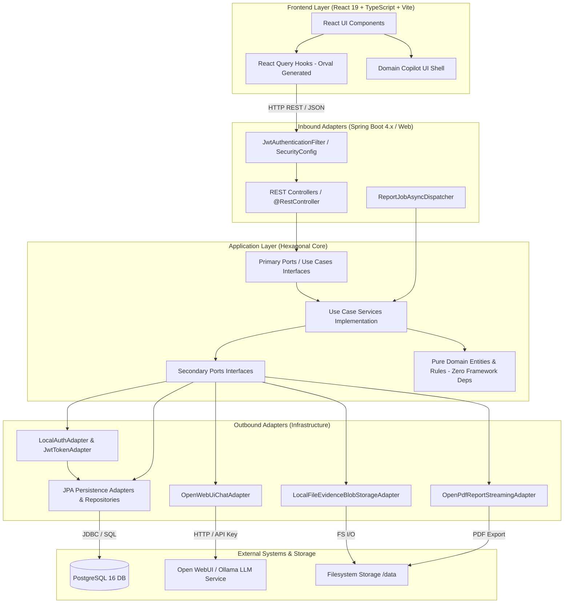
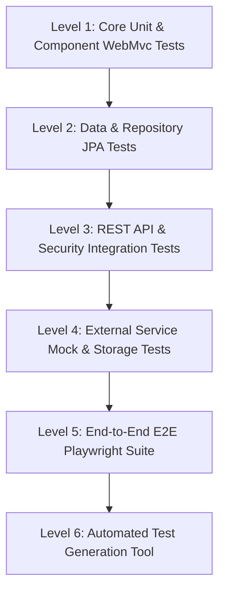

# SIGESA - Real Architecture and Integrations Analysis Document

> **Status**: Live / Technical Architecture & Integration Testing Specification  
> **Release Target**: 2.1.0 (v2.0.0 Core Normative Hierarchy + v2.1.0 Methodological Workflow)  
> **Date**: September 2026  
> **Repository Context**: `AcredIA-UMSS/sigesa-acreditacion-umss`  

---

## 1. Executive Summary & Architectural Vision

**SIGESA** (Sistema de Gestión de Acreditación UMSS) is an enterprise web system designed to manage, execute, and monitor university accreditation processes under the CEUB and ARCU-SUR accreditation frameworks. 

The architecture strictly adheres to a **Strict Hexagonal Architecture (Ports and Adapters)** pattern in the Backend and a clean separation between Presentation and Data/Logic in the Frontend. 

### Key Architectural Milestones & Evolutions
- **Release 2.0.0**: Migrated accreditation core from legacy Phase/Subphase structures to the **Normative Hierarchy Architecture** (`N1` Level 1 Area/Dimension $\rightarrow$ `N2` Level 2 Sub-dimension $\rightarrow$ `N3` Level 3 Criterion $\rightarrow$ `Indicator` $\rightarrow$ `Evidence`).
- **Release 2.1.0**: Introduced the **7-Stage Methodological Workflow** (`ADR-0005`), managing process lifecycles across Autoevaluación, Evaluación Externa, Compuertas de Calidad (Stage Gates), and Deliverable approvals.
- **AI Assistant Integration (MOD-ASSISTANT)**: Embedded multi-tool conversational LLM copilot integrated with system REST ports and PostgreSQL Full-Text Search (FTS) RAG engine.

---

## 2. Real Architecture Breakdown (C4 Level 2 / Hexagonal Layers)



### Layer Isolation Rules
1. **Domain Layer (`com.umss.sigesa.domain`)**: Pure Java 21 classes, enums, value objects, domain exceptions. Contains **zero dependencies** on Spring Framework, JPA/Hibernate, or web libraries.
2. **Application Layer (`com.umss.sigesa.application`)**: Defines Use Cases (`port.in`), Data Gateways (`port.out`), and orchestrates execution via domain services (`application.service`).
3. **Inbound Adapters (`com.umss.sigesa.adapter.in`)**: HTTP Controllers (`/api/v1/**`), DTOs, Security filters. Spring Web annotations are restricted to this package.
4. **Outbound Adapters (`com.umss.sigesa.adapter.out`)**: Persistence JPA repositories (`adapter.out.persistance`), PDF generation (`adapter.out.report`), storage adapters, and LLM HTTP integration (`adapter.out.assistant`).

---

## 3. Comprehensive Integrations Matrix

SIGESA features several internal and external integration points. Below is the technical breakdown required for integration testing:

| Integration Point | Type | Technology / Component | Protocol / Interface | Config / Environment Keys | Notes for Integration Testing |
| :--- | :--- | :--- | :--- | :--- | :--- |
| **Relational Database (Main)** | Relational Database | PostgreSQL 16 Alpine | JDBC / SQL (HikariCP) | `SPRING_DATASOURCE_URL`, `SPRING_DATASOURCE_USERNAME`, `SPRING_DATASOURCE_PASSWORD` | Tested with local Postgres (`sigesa`) or Docker service `db:5432`. |
| **Relational Database (Testing)** | In-Memory Database | H2 Database | JDBC | `application.yaml` (default spring profile) | Used during unit & fast Spring Boot context tests (`@DataJpaTest`). |
| **Database Migrations** | Schema Versioning | Flyway | DDL SQL Scripts (`classpath:db/migration`) | `spring.flyway.enabled=true` (Prod), migrations V1 through V17 | Migrations create tables, indexes (`uk_upa_active`), FTS search vectors, and stage workflow tables. |
| **Full-Text Search (FTS)** | Database Search Engine | PostgreSQL GIN Vector (`tsvector` / `ts_rank`) | SQL FTS Queries | `V11__evidence_version_fts.sql`, `V8__normative_documents.sql` | Powers Evidence FTS search (`/api/v1/evidence/search`) and Assistant RAG retrieval. |
| **AI LLM Inference API** | External HTTP Service | Open WebUI / Ollama / Groq | HTTP/1.1 REST (`POST /v1/chat/completions`) | `SIGESA_ASSISTANT_BASE_URL`, `SIGESA_ASSISTANT_API_KEY`, `SIGESA_ASSISTANT_MODEL` | Forced HTTP/1.1 protocol (`HttpClient` setting) to prevent Uvicorn HTTP/2 incompatibility. |
| **Evidence File Storage** | Blob / File Storage | Local Filesystem Adapter | File I/O Streams (`Sha256ContentHashAdapter`) | `SIGESA_EVIDENCE_STORAGE_PATH` (default `./data/evidences`) | Verifies integrity via SHA-256 content hashing upon receipt. |
| **Executive PDF Export** | Document Generation | OpenPDF (`com.github.librepdf:openpdf:2.0.3`) | Async Worker (`@Async("reportJobExecutor")`) | `SIGESA_REPORT_STORAGE_PATH` (default `./data/reports`) | Asynchronous job pipeline: `POST` 202 $\rightarrow$ Polling `GET` status $\rightarrow$ Download. |
| **Excel Export** | Document Generation | Apache POI (`org.apache.poi:poi-ooxml:5.2.5`) | Streaming Workbook Writer | Controller level streaming | Used for metric exports and detailed process data exports. |
| **API Contract Generation** | Client Code Generator | Springdoc OpenAPI v3 + Orval CLI | OpenAPI JSON (`/v3/api-docs`) | `pnpm run generate:api` | Generates TypeScript types and React Query hooks (`frontend/src/api/`). |
| **Stateless Authentication** | Security | Spring Security + JJWT 0.12.6 | HTTP Bearer Token (`Authorization: Bearer <token>`) | `SIGESA_JWT_SECRET`, `SIGESA_JWT_EXPIRATION_SECONDS` | Uses HMAC-SHA256 signing and Argon2id password hashing (`Argon2PasswordEncoder`). |

---

## 4. Subsystem & Workflow Architecture Details

### 4.1 Identity & Authorization Subsystem (MOD-AUTH)
- **Role Hierarchy**:
  - `SUPER_ADMIN`: Full system permissions.
  - `ADMIN_CENTRAL` (`[JD]` - Jefatura DUEA): Central administrator; manages users, normative templates, and global process stage approvals.
  - `DIRECTOR_CARRERA` (`[TD]` - Técnico DUEA / Director): Manages academic processes, assigns process responsibles, approves/rejects subphases/indicators.
  - `RESPONSABLE_SUBFASE` / `COORDINADOR_COMISION` (`[CC]`): Uploads evidences and submits indicators/subphases for review.
  - `EVALUADOR_EXTERNO` (`[EE]`): Read-only view for peer review evaluation.
- **Scope Enforcement**: Program assignment scope (`user_program_assignment` table with unique active index `uk_upa_active`). Cross-scope access attempts return `404 PROCESS_NOT_FOUND` to avoid resource enumeration.

### 4.2 Normative Hierarchy & Process Subsystem (MOD-PROCESS / MOD-TEMPLATE)
- **Structure Tree (Release 2.0.0)**:
  - `Template` $\rightarrow$ `Level 1` (Area/Dimension) $\rightarrow$ `Level 2` (Sub-dimension) $\rightarrow$ `Level 3` (Criterion) $\rightarrow$ `Indicator`.
- **Process Creation & Cloning**: When an accreditation process is initialized (`CreateProcessUseCase`), it deep-clones the target active normative template structure into process-specific nodes (`ProcessNormativeTreeCloner`), isolating process execution from future template modifications.

### 4.3 7-Stage Methodological Workflow Subsystem (MOD-WORKFLOW - Release 2.1.0)
- **Workflow Stages**:
  1. `ETAPA_1`: Preparación e Institucionalización
  2. `ETAPA_2`: Autoevaluación e Insumos Primarios
  3. `ETAPA_3`: Consolidador e Informe de Autoevaluación
  4. `ETAPA_4`: Evaluación Externa y Visita de Pares
  5. `ETAPA_5`: Dictamen y Resolución de Acreditación
  6. `ETAPA_6`: Plan de Mejoras y Post-Acreditación
  7. `ETAPA_7`: Monitoreo y Seguimiento Continuo
- **Quality Stage Gates (`StageGateEvaluator`)**: Validates deliverable completion and metric thresholds (e.g., Gate 2 requires 100% evidence upload coverage on active indicators).

### 4.4 AI Assistant Multi-Tool Subsystem (MOD-ASSISTANT)
- **Core Loop (`SendChatMessageService`)**: Executes an iterative multi-tool loop (up to 5 iterations).
- **Security & RBAC Guard (`AssistantToolRbacGuard`)**: Evaluates user roles against invoked tools. Admin write tools (e.g., `activate_user`, `deactivate_user`, `manage_process_phase`) require explicit two-step user confirmation (`confirmed=false` preview $\rightarrow$ `confirmed=true` execution).
- **RAG Engine (`AssistantNormativeRagService`)**: Retrieves relevant normative chunks from `normative_document` table using PostgreSQL Full-Text Search.

---

## 5. Integration Testing Strategy & Test Suites Roadmap

To achieve comprehensive integration test coverage for SIGESA, testing should be organized across the following 6 levels:



### Level 1: Unit & Component WebMvc Tests
- **Objective**: Test REST controller contracts, input validation, and HTTP status codes in isolation.
- **Key Test Classes**:
  - `com.umss.sigesa.adapter.in.web.AuthControllerTest`
  - `com.umss.sigesa.adapter.in.web.DashboardCompositeControllerTest`
  - `com.umss.sigesa.adapter.in.web.NormativeStructureControllerWebMvcTest`
  - `com.umss.sigesa.adapter.in.web.ProcessResponsibleControllerWebMvcTest`
  - `com.umss.sigesa.adapter.in.web.TemplateControllerWebMvcTest`

### Level 2: Data Persistence & Repository Tests
- **Objective**: Validate JPA queries, custom repository methods, and unique database constraints.
- **Key Test Classes**:
  - `com.umss.sigesa.adapter.out.persistance.UserProgramAssignmentRepositoryTest`
  - Flyway migration verification tests.

### Level 3: Full REST API & Security Integration Tests
- **Objective**: Execute end-to-end HTTP request/response flows against Spring Security context.
- **Key Test Classes**:
  - `com.umss.sigesa.adapter.in.web.AuthenticatedApiSmokeTest`
  - `com.umss.sigesa.adapter.in.web.EvidenceUploadControllerIT`
  - `com.umss.sigesa.adapter.in.security.JwtAuthenticationFilterTest`

### Level 4: External Service & Storage Integration Tests
- **Objective**: Verify PDF/Excel streaming generation and LLM tool execution loops with mocked external endpoints.
- **Key Test Classes**:
  - `com.umss.sigesa.adapter.out.report.OpenPdfReportStreamingAdapterTest`
  - `com.umss.sigesa.adapter.out.report.ApachePoiReportStreamingAdapterTest`
  - `com.umss.sigesa.application.service.assistant.SendChatMessageServiceToolLoopTest`
  - `com.umss.sigesa.adapter.in.web.AssistantControllerToolCallingTest`

### Level 5: End-to-End (E2E) UI & Integration Tests
- **Objective**: Validate complete user journeys in browser environment using Playwright against live containerized environment.
- **Test Config**: `playwright.config.ts`
- **Key Specs**:
  - `test/sanity.spec.ts` (Login & Root UI verification)
  - `test/ui/alex_search_evidence/search_evidence.spec.ts` (Evidence upload & search workflow)

### Level 6: Automated Test Generation (Test Generator Tool)
- **Objective**: Generate JUnit test suites automatically via local LLM container.
- **Location**: `tools/test-generator`
- **Execution Script**: `./tools/test-generator/run.sh --batch L1`

---

## 6. Execution Guide for Integration Testing

### 6.1 Backend Test Execution (Maven)
To run all backend unit and integration tests with JaCoCo coverage:

```bash
# Run unit & integration test suite
cd backend
mvn clean test

# Run tests and generate JaCoCo coverage report (Threshold > 90%)
mvn clean verify
```

### 6.2 Frontend & E2E Integration Test Execution (Playwright)
To execute browser E2E integration tests:

```bash
# Prerequisites: Ensure docker environment is up or started by Playwright webServer
docker compose up -d

# Run Playwright tests headlessly
npx playwright test

# Run Playwright tests in headed mode for visual debugging
HEADLESS=false npx playwright test
```

### 6.3 Test Generator Tool Execution
To generate supplementary test cases for specified batches:

```bash
# Display configuration and available test batches
./tools/test-generator/run.sh --show-config
./tools/test-generator/run.sh --list-batches

# Dry-run test generator for Batch L1
./tools/test-generator/run.sh --batch L1 --dry-run
```

---

## 7. Recommended Next Steps for QA / Integration Testing

1. **Verify Database Seeding**: Ensure `./db/seed.sql` is loaded properly into Postgres container for integration testing.
2. **Execute Full Test Pipeline**: Run `mvn verify` in `backend/` to confirm all 60+ Java integration tests pass cleanly with JaCoCo verification.
3. **Execute Playwright E2E**: Run `npx playwright test` to verify frontend-backend API interaction.
4. **Expand Test Suites**: Utilize `tools/test-generator` to expand coverage on newly implemented 7-stage methodological workflow endpoints (`StageWorkflowController`).
